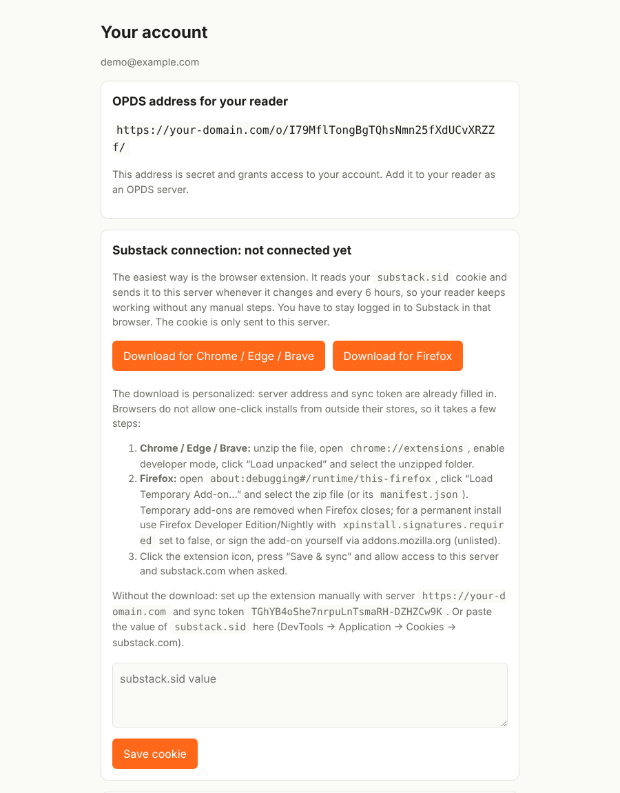

# Substack → OPDS

Multi-user server that exposes Substack articles (Latest, For you, Saved, Paid) as an OPDS catalog. Each article is converted on request into a lean EPUB (grayscale images, max. 700 px). Built for [CrossPoint](https://github.com/crosspoint-reader/crosspoint-reader) on the Xteink X4/X3, but it works with any OPDS-capable reader.



**Features:** multi-user with registration (optionally invite-only) · automatic cookie sync via Chrome and Firefox extension · configurable catalogs and article counts · EPUBs optimized for e-ink · optional author prefix for sorting · per-user encrypted storage

**Note:** Substack has no official API. The endpoints in `app/substack.py` are unofficial. They were verified against a real account, but may change at any time. If they break, all paths can be adjusted in that one place. Catalogs and the number of articles per catalog are configurable per user in the web dashboard.

**Disclaimer:** This is an independent project and is not affiliated with Substack, CrossPoint or Xteink. It uses Substack's unofficial web API and your own login cookie to read content you already have access to. Substack's terms of service may not allow automated access, so use it at your own risk and only for your personal reading. Do not run a public instance for strangers. The best setup is your own instance, or one shared with people you trust.

## Deployment with Dokploy

1. In Dokploy, create a Compose application: provider GitHub, repo `substack-opds`, branch `main`, compose path `./docker-compose.yml`, trigger *On Push*.
2. In the *Environment* tab, set `PUBLIC_URL=https://your-domain.com`, `REGISTRATION_OPEN=1` and optionally `INVITE_CODE`.
3. In the *Domains* tab, add your domain for the service `app` on port `8000` and enable HTTPS with Let's Encrypt.
4. Start the deployment. From then on, every push to `main` triggers a new deployment.

HTTPS and certificates are handled by Dokploy's Traefik. The data folder lives in the named volume `appdata`.

- Close registration: set `REGISTRATION_OPEN=0` and redeploy.
- Backup: back up the `appdata` volume. The `keys.json` inside holds the key for the stored cookies. Without it, everyone has to reconnect.

## Deployment with plain Docker

No Dokploy needed. You need a server with Docker (including the Compose plugin), a domain whose DNS points to the server, and open ports 80 and 443. The bundled `docker-compose.caddy.yml` adds Caddy, which fetches and renews Let's Encrypt certificates automatically.

```bash
git clone https://github.com/<your-user>/substack-opds.git && cd substack-opds
cp .env.example .env
nano .env   # set DOMAIN=your-domain.com and PUBLIC_URL=https://your-domain.com
docker compose -f docker-compose.yml -f docker-compose.caddy.yml up -d --build
```

Then open `https://your-domain.com`, register, and connect Substack as described below.

- Update: `git pull && docker compose -f docker-compose.yml -f docker-compose.caddy.yml up -d --build`
- Logs: `docker compose logs -f app`
- Stop: `docker compose -f docker-compose.yml -f docker-compose.caddy.yml down` (data stays in the `appdata` volume)
- Backup: `docker run --rm -v substack-opds_appdata:/data -v "$PWD":/backup alpine tar czf /backup/appdata.tgz -C /data .` (the volume name is `<folder name>_appdata`; check with `docker volume ls`)
- Already have a reverse proxy (nginx, Traefik, ...)? Skip the Caddy file, publish the port instead, and proxy your domain to it with HTTPS and the `X-Forwarded-*` headers: add `ports: ["127.0.0.1:8000:8000"]` to the `app` service in a `docker-compose.override.yml` and run `docker compose up -d --build`.
- Registration, invite code and key handling work as described under Dokploy.

## Connect Substack

**Browser extension (recommended), Chrome/Edge/Brave and Firefox:**
1. In the dashboard, under "Substack connection", download the extension for your browser. The package is personalized: server URL and sync token are already filled in. (Without the dashboard, load the `extension/` folder directly in Chrome.)
2. Chrome/Edge/Brave: unzip it, open `chrome://extensions`, enable developer mode, click "Load unpacked" and select the folder.
   Firefox: open `about:debugging#/runtime/this-firefox`, click "Load Temporary Add-on…" and select the zip. Temporary add-ons disappear when Firefox closes; for a permanent install use Developer Edition/Nightly with `xpinstall.signatures.required=false`, or sign it via addons.mozilla.org (unlisted, e.g. `npx web-ext sign`).
3. Click the extension icon, press "Save & sync" and allow access to your server and substack.com.
4. From then on, the extension sends `substack.sid` to the server whenever it changes and every 6 hours. You need to be logged in to Substack in that browser.

Browsers don't allow one-click installs from outside their stores, which is why the extension is loaded manually. The Firefox build uses `extension/manifest.firefox.json` (MV3 with `background.scripts`); the server swaps it in as `manifest.json` when building the download.

**Manually:** Paste the value of `substack.sid` into the dashboard (DevTools → Application → Cookies → substack.com).

## Web dashboard

The web interface is where each user manages their own account. Everything is per user; other users' data is never visible.

- **Register / log in:** Create an account with an email address and password. If the server sets an `INVITE_CODE`, you need it to register; if `REGISTRATION_OPEN=0`, registration is closed.
- **Substack connection:** Shows whether a `substack.sid` cookie is stored. It is filled automatically by the browser extension (personalized Chrome and Firefox downloads with install steps are right there) or can be pasted manually. You can disconnect Substack at any time.
- **Connection details:** Your personal OPDS address (`/o/<token>/`) for the reader and the sync token for the extension. Both can be rotated; the old values stop working immediately, so update the reader and extension afterwards.
- **Catalogs:** The four defaults are Latest, For you, Saved and Paid. For each catalog you can:
  - change the name,
  - set how many articles to fetch (default 30, maximum 100; Substack returns 20 per request, the server pages automatically),
  - change the Substack feed path (only `/api/...` paths or `https://substack.com/api/...` URLs are accepted),
  - disable it or add your own catalogs,
  - reset everything to the defaults.
- **Author prefix:** Optional text (max. 30 characters, e.g. `Substack - `) put in front of every author name. In the EPUB the author becomes `Prefix Lastname, Firstname` (e.g. `Substack - Hielscher, Matze`) and is also used as sort key, so readers that sort by author list all articles together. The OPDS feed shows `Prefix Firstname Lastname`. Changing it clears your cached EPUBs, so articles are rebuilt on the next download.
  Changes apply to the OPDS feed right away (feeds are cached for up to 2 minutes).
- **Delete account:** Removes your user, cookie, settings and cached EPUBs from the server.

## Set up your reader

**CrossPoint (Xteink X4/X3):**
1. Connect the device to your Wi-Fi: Settings → System → Wi-Fi Networks.
2. Add the server: Settings → System → OPDS Servers → Add Server. Alternatively, start File Transfer mode and open `http://<device-ip>/settings` in a browser.
3. Enter the root address from the dashboard, `https://your-domain.com/o/<token>/`, as the server URL. Use the root address, not a single feed; the catalogs (Latest, For you, Saved, Paid, plus your own) appear as sub-folders. Leave username and password empty.
4. Open the OPDS browser on the device, choose the server, pick a catalog and an article. The EPUB is downloaded to the device.

Menu names can differ between firmware versions. **Other readers** (KOReader, Calibre, Thorium, ...): add the same address as an OPDS catalog.

## Security

- Cookies are stored encrypted (Fernet) in SQLite, passwords as scrypt hashes.
- The OPDS address is a secret token. It can be rotated in the dashboard.
- EPUBs are cached per user and never shared (paid articles!). The cache is purged after 30 days.
- Images are only loaded from Substack hosts; the cookie is never sent to CDNs.
- Access logs are disabled so tokens don't end up in logs.
- If you run this for others: you need a privacy policy, and Substack's terms may prohibit this kind of use.

## Contributing

Issues and pull requests are welcome. Please run the smoke test (below) before submitting. If Substack changes its API, the endpoints are all in `app/substack.py`.

## License

[MIT](LICENSE)

## Local testing

```bash
python3 -m venv .venv && .venv/bin/pip install -r requirements.txt
DATA_DIR=$(mktemp -d) HTTPS_ONLY=0 .venv/bin/python tests/smoke.py
DATA_DIR=./data HTTPS_ONLY=0 .venv/bin/uvicorn app.main:app --port 8000
```
